# How timelog counts time

- **Lanes.** The day runs in lanes side by side: one per agent session, and one for you and your
  calls. Each lane works on one card at a time.
- **Agents count in full.** Two agents working 30 minutes on two cards log 30 minutes on each.
- **A card counts once.** Two agents working 30 minutes on the same card log 30 minutes.
- **Watching adds nothing.** Your windows don't count on a card while one of its agents works:
  reviewing its work as it goes is part of its time.
- **One worklog per card and day**, rounded to the nearest 5 minutes.

The rules come from Odoo's Timesheet Assistant; the parallel lanes are there for agents.

## An example day

The README's day, lane by lane. Red is what timelog asks about, grey what counts nothing.

```mermaid
gantt
    dateFormat HH:mm
    axisFormat %H:%M
    section Agent a1b2c3d4
    ABC-641 turn                 : 09:20, 09:50
    ABC-641 turn                 : 11:45, 12:20
    section Agent e5f6a7b8
    DEF-77 review turn           : 09:40, 10:30
    its subagent                 : 09:45, 10:15
    section Call
    Meet - Daily sync            : 08:58, 09:20
    section You
    Meet tab, folds into the call : 08:58, 09:20
    VS Code, ABC-641's agent works : done, 09:20, 09:35
    Jira page ABC-641, its agent works : done, 09:35, 09:50
    PR 412, DEF-77's agent works : done, 09:50, 10:10
    Slack, folds into DEF-77     : done, 10:10, 10:20
    PR 412, DEF-77's agent works : done, 10:20, 10:30
    PR 412, DEF-77 review        : 10:30, 10:40
    Q4 planning.ods, no card     : crit, 11:15, 11:45
    VS Code, ABC-641's agent works : done, 11:45, 12:20
    VS Code, its answer, ABC-641 : 12:20, 12:30
    section Your entries
    ? Meet - Daily sync          : crit, 08:58, 09:20
    DEF-77 PR review             : 10:30, 10:40
    ?                            : crit, 11:15, 11:45
    ABC-641                      : 12:20, 12:30
```



ABC-641 gets 1h15: its agent's two turns (1h05) and your 10 minutes on its answer. The agents
overlap 09:40-09:50 on two cards, so 3h42 is logged over 3h32 of wall clock.

## Lanes

| Lane | Recorded by | Its card |
|---|---|---|
| an agent session: its turns, from your prompt to its answer, subagents included | aw-watcher-agents | its folder's in `folder_cards`, else the first card its prompts name or a PR they link, for the whole session |
| you: the focused window while you're at the keyboard, and your calls (a Meet, Zoom or Teams tab playing sound) | aw-watcher-window, aw-watcher-afk, aw-watcher-web | below |

An agent counts only while a turn runs. While it waits for your next prompt or for your approval
of a tool, the time is yours, in its window. A call keeps counting while you're idle, since you're
listening.

## Your lane

Your lane is cut into pieces, one per window, browser tab or editor branch. Each piece gets its
card from the first of:

1. the card it shows, or a rule's;
2. in an agent's window: the card of the session that answered last;
3. the call in progress;
4. the agent you steer, while it works;
5. your current card;
6. otherwise `?`, asked in the review.

A piece shows a card when it's a PR (someone else's is a review), a Jira page, or a title or
branch with a card key, for 30 seconds or more. A shorter glance counts as a piece without a card,
so passing through a tab makes no worklog. [Rules](#rules) are below.

An agent's window is the one you prompted it from, or one titled like its session. Only the time
between its turns counts there: reading its answer, writing the next prompt.

You steer an agent when you prompted it or read its answer last, so the Slack minutes while it
works go with its work.

Then the agents' time is taken out of yours on their cards, so watching adds nothing.
`your_time_during_agent_turns` sets how far that goes:

| Value | Your windows during an agent's turn |
|---|---|
| `other_cards` (default) | count, but not on the card of an agent working |
| `calls` | don't count at all: only your calls and manual entries do |

### Your current card

```text
09:00        in shop_odoo, you ask agent s1 to review ABC-1's PR    current card: ABC-1
09:10-09:15  you read s1's answer in shop_odoo                      ABC-1
09:15-10:00  lunch                                                   none: a break ends it
10:00-10:02  back in shop_odoo, where s1 answered last              ABC-1
10:01        you ask agent s2 to make the release, naming no card   none: s2 has no card
10:10-10:12  you read s2's answer                                   none
10:12-10:25  releases.md, then Slack                                none: `?`
```

The day gets ABC-1 for 09:00-09:15 and 10:00-10:02, and `?` for 10:02-10:25, which the review
asks about.

Your current card is the card of whichever came last: the agent you prompted, the agent whose
answer you read, or a piece that showed a card for a minute. An agent without a card leaves you
without one, so its work is asked about instead of landing on an earlier card. A break (`timing.break_gap`,
20 minutes with nothing active) ends it.

## Rules

A rule is tried on the window title, or on `title|url` for a tab. Yours come before the built-in
ones in [timelog/rules.py](timelog/rules.py), such as Tempo going to your `tracker.admin_card`.

| Field | |
|---|---|
| `regex` | its groups fill `$1`, `$2`... in `card` and `name` |
| `card` | the card, or `-` to drop the time |
| `name` | what the review calls the piece |
| `always_active` | the tab is a call when it plays sound |
| `side_activity` | an interruption, like chat: it doesn't change your current card |
| `comment` | on the tooling and admin cards, the worklog's comment for these pieces, e.g. `timesheeting` for Tempo |

An answer holds for that day, and for the time it was given for: if a later build makes the entry
longer, the extra time is asked about. When one piece makes up more than half of the line, the review
asks "From now on too?" and offers rules from the narrowest: the title, the window or agent
session's title, the site of a tab, the repository of an editor. The rule you pick goes first in
`rules`. A page that shows a card gets no rule: what it shows always wins.

## Worklogs

A card makes one worklog a day: the time anything worked on it, its lanes counted once. It
starts at the card's first entry, since Tempo shows how long, not when. It's rounded to the
nearest 5 minutes and never under 5: 12 → 10, 13 → 15, 2 → 5.

Its comment is the first that applies:

| | Comment |
|---|---|
| you wrote one | yours |
| you posted a review on GitHub that day, or the task is a PR review | `PR review of shop_odoo#412` |
| an agent was asked to review the card, no PR found | `Review: ` and the Jira summary |
| the tooling or admin card | its agent sessions' titles and the rules' `comment`, else your last comment, else none: a window's title says where you were, not what you did |
| any other card | your last comment for it (30 days back), else its Jira summary, with its PRs |

A comment you didn't write is rebuilt with the day, so it follows the day's PRs until you write
one. The review shows each card's comment with when its time was and its largest windows, so you
can tell what it was before you keep or write one.

## Days left behind

`timelog` without a date first offers the days of the last two weeks that weren't pushed (or
entered in Tempo), from `start_date`, the oldest first.

A pushed day keeps its entries as you pushed them. A later timelog could count it differently,
and your answers might no longer match its entries, so it isn't built again from ActivityWatch.
Its review, `day` and `summary` start from what you pushed, plus any work it doesn't have: a
stretch of 15 minutes or more, such as an agent that went on after the push. Only that work is
asked about. You can still change anything in the editor (`timelog 16.11 --edit`), and the push
updates only what changed. `timelog day 16.11 --rebuild` builds it again anyway, and lists what changes per
card against what you pushed.

## Compared with the Timesheet Assistant

timelog shares its ideas, not its code (Odoo enterprise license): the match string, `name`,
`always_active`, side activities, editors as `repository|branch`. It differs in four ways:

- agents get their own lanes;
- a call needs the tab to play sound;
- Slack without a rule folds into your current card;
- the time goes to Jira.
